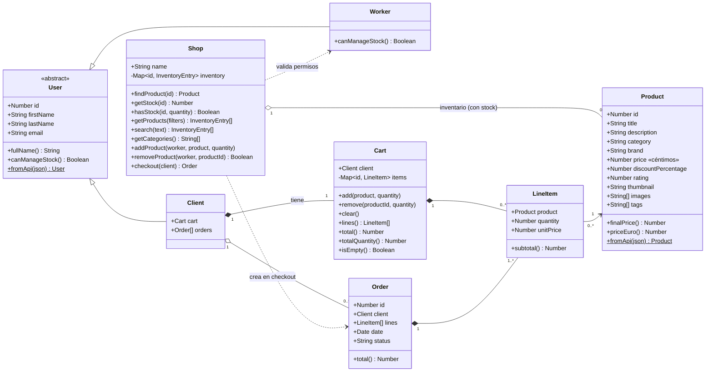

# Diagrama de clases

> GitHub y VS Code (con la extensión *Markdown Preview Mermaid Support*) renderizan este bloque automáticamente.
> También se puede pegar en https://mermaid.live



## Cómo leerlo

| Símbolo | Significa | En nuestro modelo |
|---|---|---|
| `<\|--` | Herencia (*es un*) | Un `Client` **es un** `User` |
| `*--` | Composición (el todo crea y destruye la parte) | El `Cart` no existe sin su `Client` |
| `o--` | Agregación (el todo usa partes que existen por sí solas) | Un `Product` existe aunque no esté en ninguna tienda |
| `-->` | Asociación (referencia) | Cada `LineItem` apunta a un `Product` |
| `..>` | Dependencia (lo usa puntualmente) | `Shop` crea un `Order` al hacer checkout |
| `$` | Método estático | `Product.fromApi(json)` |
| `+` / `-` | Público / privado (`#` en JS) | `inventory` solo se toca desde `Shop` |

## Estructura de datos interna de `Shop`

```js
inventory = Map {
  81 => { product: Product{ id: 81, title: "Blue & Black Check Shirt", price: 2999, ... }, stock: 3 },
  82 => { product: Product{ id: 82, ... }, stock: 1 },
}
```

Un único `Map` sustituye al par `products[]` + `stock Map` del primer borrador:
producto y stock no pueden desincronizarse y las búsquedas por id son O(1).