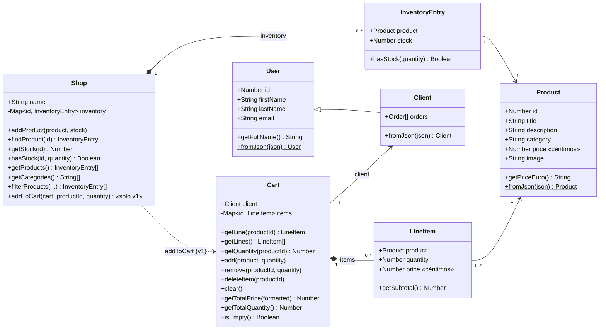
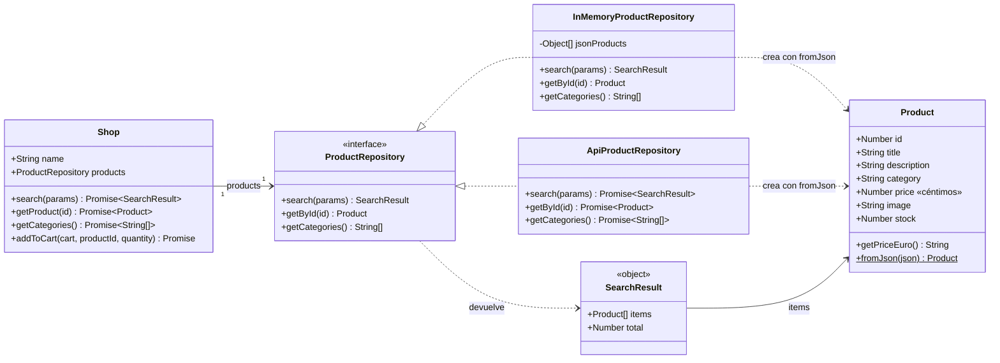
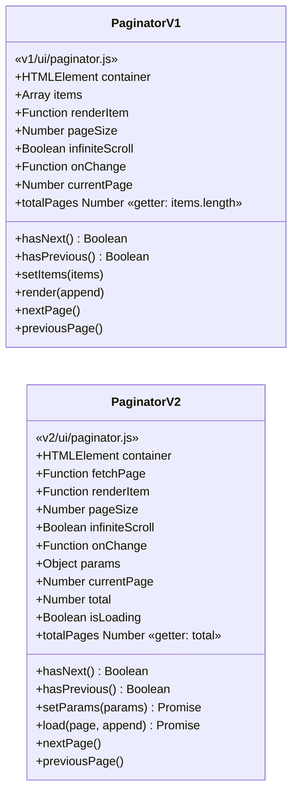

# Diagrama de clases

> GitHub y VS Code (con la extensión *Markdown Preview Mermaid Support*) renderizan estos bloques automáticamente.
> También se pueden pegar en https://mermaid.live

Las tres versiones comparten las mismas clases de modelo (`Product`, `LineItem`, `Cart`, `User`, `Client`). Lo que cambia es `Shop` y, en `v1` y `v2`, la clase `Paginator`.

## 1. Modelo común y `Shop` en `sencilla/` y `v1/`



`filterProducts` recibe los filtros de forma distinta según la versión:

- `sencilla/`: `filterProducts(search, category)` (dos parámetros).
- `v1/`: `filterProducts({ search, category })` (un objeto, el mismo que entrega el formulario).

## 2. `Shop` y repositorio en `v2/`

En `v2` la tienda no guarda productos: los pide a un repositorio. El stock pasa a `Product` (como lo manda la API) y desaparece `InventoryEntry`. `Cart`, `LineItem`, `User` y `Client` son iguales que en el diagrama anterior.

La aplicación usa `ApiProductRepository`; `InMemoryProductRepository` se conserva para trabajar sin conexión. Como el de la API tiene que esperar a la red, los métodos de `Shop` son `async` y devuelven promesas.



`ProductRepository` no existe como archivo: JavaScript no tiene interfaces. Es el **contrato** (los tres métodos y lo que devuelven) que cumplen los dos repositorios, y por eso se pueden intercambiar cambiando una sola línea de `index.js`.

`ApiProductRepository.search` cumple el contrato aunque la API no permita combinar búsqueda y categoría: en ese caso pide todos los resultados de la búsqueda, filtra la categoría y corta la página él mismo.

## 3. `Paginator` en `v1/` y `v2/`

Mismo nombre y mismos métodos públicos para navegar; cambia de dónde saca los datos.



| | `v1` | `v2` |
|---|---|---|
| Recibe | `items`: todos los datos | `fetchPage`: una función que devuelve `{ items, total }` |
| Corta la página | Él mismo, con `slice` | Quien responde a `fetchPage` |
| Cambiar los datos / filtros | `setItems(items)` | `setParams(params)` |
| Pintar | `render(append)` | `load(page, append)`, `async` |
| Errores | — (los datos ya están) | `try/catch`: muestra un mensaje si la petición falla |

En `sencilla/` no hay clase `Paginator`: el mismo trabajo lo hacen las variables `currentPage` y `productsToShow` y la función `showPage()` de `index.js`.

## 4. Módulos que no son clases

Además de las clases, cada versión tiene dos módulos de funciones, **idénticos en las tres**:

| Archivo | Funciones | Responsabilidad |
|---|---|---|
| `api.js` | `fetchProducts(params)`, `fetchProductById(id)`, `fetchCategories()` | Único sitio con `fetch`. Devuelve los datos tal cual los manda DummyJSON. |
| `storage.js` | `saveCart(cart)`, `loadCartLines()` | Único sitio con `localStorage`. Guarda y lee `[{ id, quantity }]`. |

Quién los usa:

- `sencilla/` y `v1/`: `index.js` llama a `fetchProducts()` una vez y crea `Product` con `fromJson`.
- `v2/`: `ApiProductRepository` llama a las tres funciones de `api.js`.
- Las tres versiones: `index.js` llama a `saveCart` cada vez que cambia el carrito y a `loadCartLines` al arrancar.

## 5. Cómo leer los diagramas

| Símbolo | Significa | En nuestro modelo |
|---|---|---|
| `<\|--` | Herencia (*es un*) | Un `Client` **es un** `User` |
| `<\|..` | Implementa (cumple un contrato) | `InMemoryProductRepository` cumple el contrato de `ProductRepository` |
| `*--` | Composición (la parte no tiene sentido sin el todo) | Una `InventoryEntry` solo existe dentro de una `Shop`; un `LineItem`, dentro de un `Cart` |
| `-->` | Asociación (referencia) | Cada `LineItem` apunta a un `Product` |
| `..>` | Dependencia (lo usa puntualmente) | El repositorio usa `Product.fromJson` para crear productos |
| `$` | Método estático | `Product.fromJson(json)` |
| `+` / `-` | Público / de uso interno | `inventory` e `items` solo se deberían tocar desde su clase |

## 6. Estructuras de datos internas

`Shop.inventory` en `sencilla/` y `v1/`:

```js
inventory = Map {
  1  => InventoryEntry { product: Product { id: 1, title: "Essence Mascara Lash Princess", price: 999, ... }, stock: 99 },
  26 => InventoryEntry { product: Product { id: 26, title: "Green Chili Pepper", price: 99, ... }, stock: 3 },
  ...
}
```

`Cart.items` (todas las versiones):

```js
items = Map {
  1 => LineItem { product: Product { id: 1, ... }, quantity: 2, price: 999 },
}
// getTotalPrice()     → 1998
// getTotalPrice(true) → "19.98€"
```

Respuesta de `search` en `v2/` (`ApiProductRepository` e `InMemoryProductRepository`):

```js
{
  items: [ Product { id: 121, title: "iPhone 5s", ... }, ... ], // solo la página pedida
  total: 4                                                      // resultados de toda la búsqueda
}
```

Usar un `Map` con el `id` como clave hace que buscar un producto o una línea del carrito sea inmediato, sin recorrer arrays.

Contenido de `localStorage` (clave `"cart"`, todas las versiones). Solo ids y cantidades: al arrancar se reconstruyen los `Product` y `LineItem` de verdad:

```json
[{"id":1,"quantity":1},{"id":26,"quantity":3}]
```
