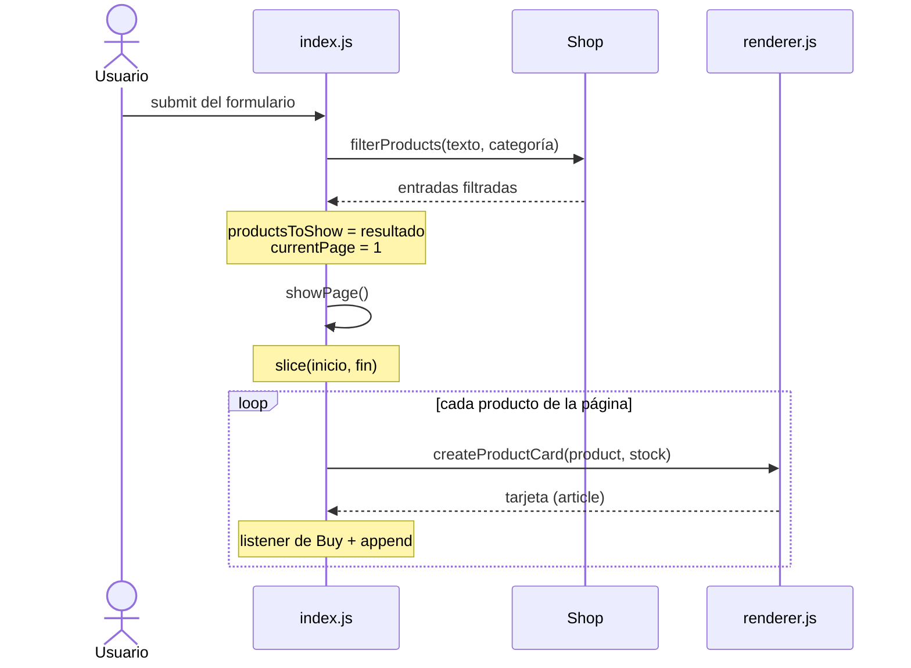
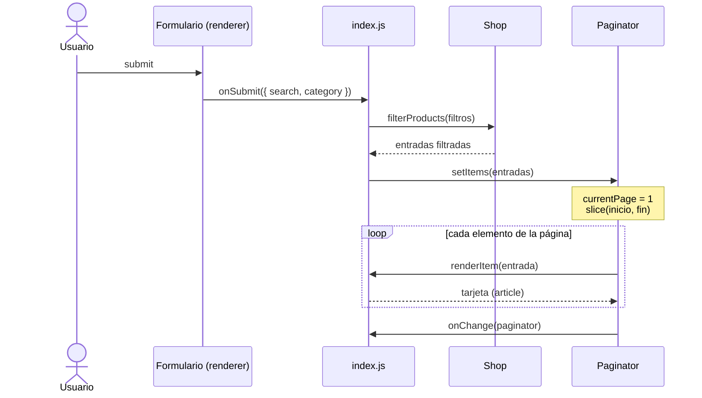
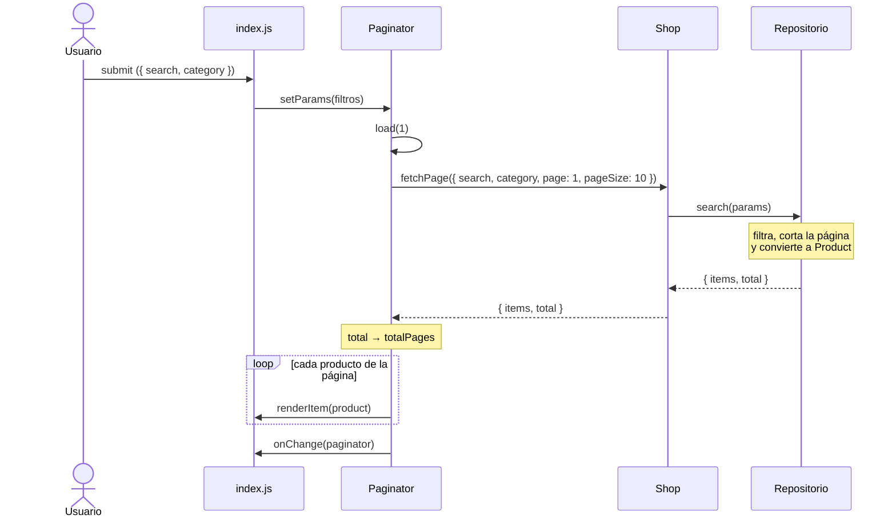

# Memoria técnica — Tienda

> Versión 1.1 · Proyecto completo: fases 1 (modelo), 2 (DOM) y 3 (API + `localStorage`) · Octubre 2026

---

## 1. Descripción del proyecto

Aplicación web de comercio electrónico. Un **cliente** puede consultar el catálogo paginado, buscar productos por texto, filtrarlos por categoría y añadirlos a su carrito, que respeta el stock disponible, muestra el total en euros y **se conserva al recargar la página**.

El catálogo se carga de la API pública **DummyJSON** (sección 8). Cada versión conserva una copia local de los datos (`data/products.json`, con el mismo formato que la API) para poder trabajar sin conexión. El carrito se guarda en `localStorage` (sección 9).

La aplicación se entrega en **tres versiones** que hacen lo mismo con distinta organización del código (`sencilla/`, `v1/`, `v2/`), para poder estudiar la misma solución con distintos niveles de abstracción. Se describen en la sección 7.

### 1.1 Objetivos de aprendizaje

- Modelar un dominio real con clases, herencia, composición y métodos estáticos.
- Crear y modificar elementos del DOM, y responder a eventos (`click`, `submit`).
- Paginar y filtrar una lista de datos.
- Separar la **lógica de negocio** (clases del modelo) de la **presentación** (DOM) y del **acceso a datos** (JSON / API).
- Entender la diferencia entre **paginar en el cliente** y **paginar en el servidor**.
- Consumir una API con `fetch`, `async` / `await` y gestionar los errores de red.
- Guardar y recuperar datos en `localStorage`, reconstruyendo los objetos de nuestras clases.

### 1.2 Alcance

| Dentro | Fuera |
|---|---|
| Catálogo paginado con imagen, precio y stock | Pasarela de pago real |
| Búsqueda por texto y filtro por categoría | Registro / login real (el cliente está simulado) |
| Carrito con control de stock, total, quitar unidades y vaciar | Pedidos, checkout e historial (ver ampliaciones, §12) |
| Carga del catálogo desde la API, con mensajes de carga y error | Backend propio y base de datos |
| Carrito guardado en `localStorage` | Gestión de stock por trabajadores (ver ampliaciones, §12) |

---

## 2. Actores

| Actor | Descripción |
|---|---|
| **Cliente** | Usuario que navega por el catálogo y añade productos a su carrito. En la aplicación hay un único cliente simulado, creado en `index.js`. |
| **Sistema / API** | Fuente del catálogo (DummyJSON). Sin conexión, una copia local en `data/products.json`. |

---

## 3. Requisitos

### 3.1 Requisitos funcionales

| ID | Requisito | Prioridad | Estado |
|---|---|---|---|
| RF-01 | Mostrar el catálogo en tarjetas con imagen, título, descripción, precio y stock | Alta | ✅ Hecho |
| RF-02 | Paginar el catálogo de 10 en 10 | Alta | ✅ Hecho |
| RF-03 | Navegar entre páginas con botones *Previous* / *Next*, desactivados en los extremos | Alta | ✅ Hecho |
| RF-04 | Mostrar la página actual y el total de páginas ("Page X of Y") | Media | ✅ Hecho |
| RF-05 | Buscar productos por texto en el título, sin distinguir mayúsculas | Alta | ✅ Hecho |
| RF-06 | Filtrar productos por categoría, con opción para ver todas | Alta | ✅ Hecho |
| RF-07 | Combinar búsqueda y categoría; al filtrar se vuelve a la página 1 | Media | ✅ Hecho |
| RF-08 | Añadir un producto al carrito (una unidad por click) | Alta | ✅ Hecho |
| RF-09 | Impedir añadir más unidades de las que hay en stock, avisando al usuario | Alta | ✅ Hecho |
| RF-10 | Mostrar el número de artículos del carrito en un botón | Alta | ✅ Hecho |
| RF-11 | Mostrar/ocultar el detalle del carrito: líneas, cantidades, subtotales y total | Alta | ✅ Hecho |
| RF-12 | Cargar el catálogo desde la API de DummyJSON | Alta | ✅ Hecho |
| RF-13 | Mostrar un mensaje mientras se cargan los datos de la API | Media | ✅ Hecho |
| RF-14 | Mostrar un mensaje si la API no responde | Media | ✅ Hecho |
| RF-15 | Quitar unidades de un producto desde el carrito (botón −1) | Alta | ✅ Hecho |
| RF-16 | Vaciar el carrito | Media | ✅ Hecho |
| RF-17 | Conservar el carrito al recargar la página (`localStorage`) | Media | ✅ Hecho |

### 3.2 Requisitos no funcionales

| ID | Requisito | Cómo se cumple |
|---|---|---|
| RNF-01 | JavaScript vanilla (ES2022+), sin frameworks. | Módulos ES nativos (`import`/`export`), sin dependencias. |
| RNF-02 | Las clases del modelo no acceden al DOM, a `fetch` ni a `localStorage`. | `core/` no usa `document`, `fetch` ni `localStorage`. El DOM está en `index.js` y `ui/`; `fetch`, solo en `api.js`; `localStorage`, solo en `storage.js`. |
| RNF-03 | Los importes se almacenan como **enteros en céntimos**. | `Product.fromJson()` convierte con `Math.round(price * 100)`. `formatPrice()` los muestra como `19.99€`. |
| RNF-04 | Los datos inválidos se señalan con errores (`throw`), no con `console.log`. | `checkProduct`, `checkClient`, `checkPositiveNumber` lanzan errores propios (`utils/errors.js`). En `v1`/`v2` también `NotEnoughStockError`. |
| RNF-05 | Código en inglés; documentación y comentarios en español. | Nombres de clases, métodos y variables en inglés. |
| RNF-06 | Interfaz usable en móvil. | CSS con `flex` en columna y *media query* a partir de 760 px. |
| RNF-07 | Se ejecuta en el navegador con un servidor local. | Live Server (instrucciones en el README). |

### 3.3 Historias de usuario

- **HU-01** — *Como cliente, quiero ver el catálogo por páginas para no tener una lista interminable.*
  - ✅ Al entrar se ven 10 productos y "Page 1 of 20".
  - ✅ *Previous* está desactivado en la página 1 y *Next* en la última.
- **HU-02** — *Como cliente, quiero filtrar por categoría para encontrar rápido lo que busco.*
  - ✅ Al elegir "smartphones" solo aparecen teléfonos.
  - ✅ Al elegir "All" vuelven a aparecer todos.
- **HU-03** — *Como cliente, quiero buscar por nombre.*
  - ✅ Buscar "iphone" en la categoría "smartphones" muestra 4 resultados en 1 página.
  - ✅ Una búsqueda sin resultados muestra la lista vacía y "Page 1 of 1".
- **HU-04** — *Como cliente, quiero que no me deje comprar más unidades de las que hay.*
  - ✅ "Green Chili Pepper" tiene stock 3: la cuarta pulsación de *Buy* muestra el aviso y el carrito se queda en 3 unidades de ese producto.
- **HU-05** — *Como cliente, quiero ver cuánto llevo gastado.*
  - ✅ Dos unidades de "Essence Mascara Lash Princess" (9.99 €) muestran 🛒 2 y "Total: 19.98€".
- **HU-06** — *Como cliente, quiero corregir mi carrito.*
  - ✅ El botón −1 de una línea quita una unidad; si era la última, la línea desaparece.
  - ✅ *Empty cart* deja el carrito vacío y muestra "The cart is empty".
- **HU-07** — *Como cliente, no quiero perder mi carrito si recargo la página.*
  - ✅ Con 1 máscara y 3 Green Chili Pepper en el carrito, al recargar aparecen 🛒 4 y "Total: 12.96€".
  - ✅ Si lo guardado está estropeado, la tienda arranca con el carrito vacío en lugar de romperse.
- **HU-08** — *Como cliente, quiero saber qué pasa si la tienda no carga.*
  - ✅ Mientras llegan los datos se ve "Loading products..."; si la API no responde, un mensaje de error.

---

## 4. Reglas de negocio

| ID | Regla |
|---|---|
| RN-01 | Un producto se identifica por su `id` (el que da la API). Nunca hay dos entradas con el mismo id en la tienda. |
| RN-02 | El stock es un entero ≥ 0. |
| RN-03 | Un producto con stock 0 **sigue en el catálogo**. No se puede añadir al carrito (en `v1` y `v2` su botón *Buy* aparece desactivado). |
| RN-04 | Al añadir al carrito se comprueba que **unidades en el carrito + unidades nuevas ≤ stock**. |
| RN-05 | Añadir al carrito **no descuenta** stock: el stock solo bajaría al hacer un pedido (fuera de alcance, §12). |
| RN-06 | Si se añade un producto que ya está en el carrito, se suman las unidades a su línea y se actualiza el precio. |
| RN-07 | Quitar del carrito tantas unidades como hay (o más) elimina la línea. |
| RN-08 | La búsqueda ignora espacios al principio y al final y no distingue mayúsculas. Un filtro vacío significa "no filtrar por eso". |
| RN-09 | En `localStorage` solo se guarda el `id` y la cantidad de cada línea. Al recuperar el carrito se vuelve a pedir cada producto (precio y stock actuales) y se descartan las líneas cuyo producto ya no existe o no tiene stock suficiente. |
| RN-10 | El carrito se guarda cada vez que cambia: al añadir, al quitar y al vaciar. |

---

## 5. API y mapeo de datos

### 5.1 Elección de la API

Se evaluaron tres APIs públicas de comercio electrónico:

| API | Productos | Stock | Sin API key | Valoración |
|---|---|---|---|---|
| **DummyJSON** | 194 productos en 24 categorías | ✅ | ✅ | **Elegida** |
| FakeStoreAPI | 20 productos | ❌ | ✅ | Muy simple, sin stock |
| Platzi Fake Store | Categorías genéricas | ❌ | ✅ (lectura) | Datos editables por cualquiera; a veces aparecen productos basura |

**Motivos:** DummyJSON devuelve el campo `stock`, que encaja directamente con nuestra lógica de inventario, y admite paginación (`limit`, `skip`), búsqueda y filtrado por categoría desde el servidor, lo que permite construir la versión `v2`.

### 5.2 Formato de un producto en DummyJSON

`GET https://dummyjson.com/products/{id}` (campos relevantes; se omiten `dimensions`, `meta`, `sku`, `reviews`, etc.)

```json
{
  "id": 1,
  "title": "Essence Mascara Lash Princess",
  "description": "…",
  "category": "beauty",
  "price": 9.99,
  "discountPercentage": 10.48,
  "rating": 2.56,
  "stock": 99,
  "brand": "Essence",
  "images": ["https://cdn.dummyjson.com/…/1.webp"],
  "thumbnail": "https://cdn.dummyjson.com/…/thumbnail.webp"
}
```

Los listados vienen envueltos: `{ "products": [...], "total": 194, "skip": 0, "limit": 30 }`. El campo `total` es el número de resultados **de la consulta completa**, no de la página: es lo que usa `v2` para saber cuántas páginas hay.

### 5.3 Mapeo API → modelo

| Campo API | Clase / propiedad | Transformación |
|---|---|---|
| `id` | `Product.id` | Ninguna. |
| `title` | `Product.title` | Ninguna. |
| `description` | `Product.description` | Ninguna. |
| `category` | `Product.category` | Ninguna (slug: `mens-shirts`). |
| `price` | `Product.price` | `Math.round(price * 100)` → céntimos. |
| `images[0]` | `Product.image` | Solo se guarda la primera imagen. |
| `stock` | `sencilla`/`v1`: `Shop.inventory.get(id).stock` · `v2`: `Product.stock` | Ninguna. Ver la decisión en §6.1. |
| `discountPercentage`, `rating`, `brand`, `tags`, `reviews` | — | No se usan (ver ampliaciones, §12). |

La conversión se centraliza en `Product.fromJson(json)`, para que si la API cambia solo haya que tocar un sitio.

> **Por qué `Math.round` y no `parseInt`:** `9.99 * 100` da `998.9999999999999` por cómo se representan los decimales. `parseInt` lo trunca a `998` (un céntimo menos); `Math.round` da `999`.

---

## 6. Diseño del modelo

Diagrama de clases completo: [`diagrama-clases.md`](diagrama-clases.md).

### 6.1 Decisiones de diseño

| Decisión | Motivo |
|---|---|
| `Shop.inventory` es un único `Map<id, InventoryEntry>` (`sencilla`, `v1`) | Producto y stock van juntos y no pueden desincronizarse. Buscar por id es inmediato. |
| En `v2` el stock va dentro de `Product` | Con una API, la tienda no tiene todos los productos en memoria: el stock llega con cada producto, tal como lo manda el servidor. |
| La categoría es una **propiedad**, no una subclase | Las subclases solo tienen sentido si cambian el comportamiento. Una camisa y un perfume se comportan igual; una clase por categoría obligaría a crear una clase nueva por cada categoría de la API. |
| `Cart` separado de `Shop` | El carrito pertenece al cliente. La tienda solo interviene para comprobar el stock. |
| `LineItem` guarda el precio | Así el total del carrito no depende de que el producto siga cargado o cambie de precio. |
| Precios en céntimos | `0.1 + 0.2 !== 0.3` en JavaScript. Con enteros los totales son exactos. |
| `formatPrice()` en `utils/functions.js` | Un único sitio para dar formato a los precios (`Product`, `Cart` y la interfaz lo usan). |
| Errores propios (`NotAProductError`, `NotEnoughStockError`…) | Quien llama decide cómo mostrarlos (en la interfaz, con `alert`). Con `console.log` la interfaz no se enteraría del fallo. |
| Las funciones de `ui/` solo crean elementos | Los eventos se conectan en `index.js`, que es el único archivo que conoce todas las piezas. |
| `fetch` solo en `api.js` y `localStorage` solo en `storage.js` | Si cambia la API o la forma de guardar, solo se toca un archivo. Ambos archivos son **idénticos en las tres versiones**. |
| En `localStorage` se guarda `[{ id, quantity }]`, no el carrito entero | `JSON.stringify` convierte las instancias en objetos normales y se pierden los métodos (`getSubtotal`, `getPriceEuro`…). Guardando solo ids, al arrancar se reconstruyen `Product` y `LineItem` de verdad, y con datos actualizados (§9). |
| Los listeners se añaden **una sola vez** | Cada tarjeta recibe su listener al crearse; los botones fijos (paginación, carrito, formulario) se enganchan al arrancar. Ver problema 1 en §6.2. |

### 6.2 Revisión del código inicial

Problemas encontrados en la primera versión hecha en clase y cómo se resolvieron:

| # | Problema | Consecuencia | Solución |
|---|---|---|---|
| 1 | Cada cambio de página volvía a añadir `addEventListener` a todos los botones *Buy*, y `renderCart` añadía otro listener al carrito en cada repintado | Con scroll infinito, un click añadía el producto varias veces; el carrito acumulaba listeners | El listener se añade al crear cada tarjeta; los fijos, una vez al arrancar |
| 2 | `ShopManager` estaba en `core/` pero manipulaba el DOM | Se rompía la regla de oro (RNF-02) | Se elimina; la conexión entre piezas se hace en `index.js` |
| 3 | `parseInt(price * 100)` | Precios con un céntimo de menos (9.99 → 998) | `Math.round` |
| 4 | El formulario de filtros no hacía nada (y al pulsar *Search* recargaba la página) | No se podía filtrar | Evento `submit` con `event.preventDefault()` y filtrado en `Shop` |
| 5 | No había opción para "todas las categorías" | Al elegir una categoría no se podía volver atrás | Opción *All* con valor `""` |
| 6 | El stock de todos los productos era 5 fijo | Se ignoraba el stock real de la API | Se usa `json.stock` |
| 7 | El subtotal y el total del carrito se mostraban en céntimos | "Total: 1998" en vez de "19.98€" | `formatPrice()` |
| 8 | No se comprobaba el stock al añadir al carrito | Se podían añadir unidades sin límite | Comprobación de RN-04 |
| 9 | El paginador calculaba el nº de páginas una sola vez, en el constructor | Al filtrar, el número de páginas era incorrecto | Se recalcula siempre (`getTotalPages()` / getter `totalPages`) |
| 10 | Con scroll infinito, *Previous* volvía a añadir la página anterior al final | Productos duplicados | Con scroll infinito, *Previous* no hace nada |

---

## 7. Las tres versiones

Las tres versiones comparten el modelo (`Product`, `Cart`, `User`, `utils/`) y se diferencian en cómo se organiza la paginación y de dónde salen los datos.

### 7.1 `sencilla/` — todo a la vista

**Idea:** el estado de la página son dos variables y todo lo hace una función.

```js
const PRODUCTS_PER_PAGE = 10;
let currentPage = 1;
let productsToShow = shop.getProducts(); // al filtrar, aquí se guarda el resultado
```

- `showPage()` calcula qué productos tocan con `slice`, crea las tarjetas, les añade el listener de *Buy* y actualiza los botones de paginación.
- Los botones *Previous* / *Next* cambian `currentPage` y llaman a `showPage()`.
- El formulario está escrito en el HTML. Al enviarlo: `productsToShow = shop.filterProducts(texto, categoría)`, `currentPage = 1` y `showPage()`.
- `buyProduct()` comprueba el stock con un `if` y, si no hay, muestra un `alert` y sale con `return`.
- `ui/renderer.js` solo crea elementos (tarjeta, opciones del `<select>`, carrito). No decide qué pasa al hacer click.

`index.js` se lee de arriba abajo: datos → estado → elementos del HTML → funciones → eventos → inicio.



**Ventajas:** muy poco que aprender aparte del DOM; se puede seguir con el depurador paso a paso.
**Inconvenientes:** la paginación no se puede reutilizar para otra lista (usuarios, pedidos…) sin copiar el código.

### 7.2 `v1/` — paginador reutilizable, paginación en el cliente

**Idea:** sacar la paginación a una clase `Paginator` que no sabe nada de productos.

```js
const paginator = new Paginator({
    containerId: "product__list",
    items: shop.getProducts(),                                   // TODOS los datos
    renderItem: (entry) => createProductCard(entry, handleBuy),  // cómo pintar cada uno
    pageSize: 10,
    onChange: (p) => { /* actualizar botones y "Page X of Y" */ }
});
```

- El paginador recibe **todos** los elementos y corta la página con `slice`.
- `totalPages` es un *getter* que se recalcula a partir de `items.length`.
- Al filtrar: `paginator.setItems(shop.filterProducts(filtros))`, que vuelve a la página 1.
- `onChange` avisa a `index.js` después de cada pintado: el paginador no toca los botones.
- El constructor recibe un **objeto de opciones**: con 6 parámetros, el orden sería difícil de recordar.
- `renderFilterForm(sectionId, categorías, onSubmit)` crea el formulario y entrega `{ search, category }` mediante un *callback*, sin saber quién lo usa.
- La regla de stock pasa al modelo: `Shop.addToCart(cart, id, cantidad)` lanza `NotEnoughStockError`, y `index.js` la captura con `try/catch`.
- Opción `infiniteScroll: true`: *Next* añade la página debajo en vez de sustituirla.



**Ventajas:** el mismo `Paginator` sirve para cualquier lista. Cada pieza tiene una sola responsabilidad.
**Inconvenientes:** hay que entender *callbacks*, objetos de opciones y *getters*. Sigue necesitando **todos** los datos en el navegador.

### 7.3 `v2/` — paginación en el servidor con repositorio

**Idea:** con una API real no se descargan los 194 productos para mostrar 10. Se pide **una página** y el servidor devuelve esa página y el **total** de resultados.

**El repositorio** (`repositories/InMemoryProductRepository.js`) es el objeto que obtiene los datos. Cumple un **contrato** que también cumplirá el repositorio de la API:

```
search({ search, category, page, pageSize })  →  { items: Product[], total: number }
getById(id)                                    →  Product | null
getCategories()                                →  string[]
```

**`Shop`** ya no guarda productos: sabe dónde pedirlos. Sus métodos `search`, `getProduct` y `getCategories` delegan en el repositorio, y le queda la regla de negocio `addToCart`. Todos son `async`, porque el repositorio de la API tiene que esperar a la red.

**El paginador** ya no recibe datos, sino una función para pedirlos:

```js
const paginator = new Paginator({
    containerId: "product__list",
    fetchPage: (params) => shop.search(params),   // el paginador pide, la tienda responde
    renderItem: (product) => createProductCard(product, handleBuy),
    pageSize: 10,
    onChange: (p) => { /* … */ }
});
```

- `load(page)` llama a `fetchPage({ ...params, page, pageSize })`, guarda el `total` de la respuesta y pinta los `items`.
- `totalPages` sale de `total`, no de los datos que tiene (que son solo una página).
- Los filtros son un objeto opaco: `setParams(filtros)` los guarda, se los pasa a `fetchPage` en cada petición y vuelve a la página 1. El paginador no sabe qué significan.



**Ventajas:** es como se trabaja con APIs reales. Para pasar a la API solo se sustituye el repositorio (una línea en `index.js`); paginador, tienda e interfaz no cambian.
**Inconvenientes:** más archivos y más conceptos (contrato, repositorio, delegación).

### 7.4 Comparación

| | `sencilla/` | `v1/` | `v2/` |
|---|---|---|---|
| Dónde están todos los datos | Navegador | Navegador | "Servidor" (repositorio) |
| Quién corta la página | `showPage()` | `Paginator` | Repositorio |
| De dónde sale el nº de páginas | `productsToShow.length` | `items.length` | `total` de la respuesta |
| Qué se cambia al filtrar | `productsToShow` | `paginator.setItems(...)` | `paginator.setParams(...)` |
| Dónde está el stock | `InventoryEntry` en `Shop` | `InventoryEntry` en `Shop` | `Product.stock` |
| Comprobación de stock | `if` en `index.js` | `Shop.addToCart()` + `throw` | `Shop.addToCart()` + `throw` |
| Formulario | HTML | `renderFilterForm()` con callback | `renderFilterForm()` con callback |
| Peticiones a la API al arrancar | 1 (todos los productos) | 1 (todos los productos) | 2 (categorías + página 1) |
| Peticiones al cambiar de página o filtrar | Ninguna | Ninguna | 1 por cambio |
| Recuperar el carrito guardado | Busca en `Shop` | `Shop.addToCart()` | `await shop.addToCart()` (1 petición por línea) |
| Archivos de JS | 10 | 11 | 13 |
| Líneas de JS (sin datos) | ~615 | ~715 | ~810 |
| Conceptos nuevos | DOM, eventos, `slice` | + callbacks, objeto de opciones, getter | + repositorio, contrato, delegación |

**Archivos que cambian de `v1` a `v2`:** `core/Product.js` (stock), `core/Shop.js`, `ui/paginator.js`, `ui/renderer.js` (la tarjeta recibe un `Product`) e `index.js`, más la carpeta nueva `repositories/`. `Cart`, `User`, `utils/`, `api.js`, `storage.js`, el HTML y el CSS son idénticos.

### 7.5 ¿Cuándo usar cada enfoque?

- **Paginación en el cliente** (`sencilla`, `v1`): cuando hay pocos datos (cientos) o ya se tienen todos. Filtrar es instantáneo y se pueden combinar filtros libremente.
- **Paginación en el servidor** (`v2`): cuando hay muchos datos (miles o más) o la API pagina obligatoriamente. Cada cambio de página o de filtro es una petición, y solo se puede filtrar por lo que la API permita.

---


## 8. Conexión con la API

Una **única función** de acceso a la API sirve para las tres versiones. La clave es que `api.js` devuelve **lo que manda la API, sin adaptarlo** a ninguna versión; cada versión se adapta a él. Por eso `api.js` es idéntico en las tres carpetas.

### 8.1 `api.js`

| Función | Petición | Devuelve |
|---|---|---|
| `fetchProducts({ search, category, page, pageSize })` | `/products`, `/products/search?q=` o `/products/category/x`, con `limit` y `skip` | `{ products, total, skip, limit }` |
| `fetchProductById(id)` | `/products/{id}` | El producto, o `null` si no existe |
| `fetchCategories()` | `/products/category-list` | `["beauty", "fragrances", …]` |

Detalles:

- `page` y `pageSize` son nuestros; la API usa `limit` y `skip`. La traducción es `skip = (page - 1) * pageSize`.
- `pageSize = 0` (el valor por defecto) pide **todos** los productos: DummyJSON usa `limit=0` para eso.
- El texto de búsqueda se pasa por `encodeURIComponent` para que espacios o símbolos no rompan la URL.
- Si la respuesta no es correcta (`!response.ok`), `fetchProducts` y `fetchCategories` lanzan un error; quien llama decide cómo mostrarlo.

### 8.2 `sencilla/` y `v1/`: todos los productos de una vez

Como paginan en el cliente, piden todos los productos al arrancar. `data` tiene la misma forma que `products.json`, así que el resto del código no cambió respecto a la versión con el JSON local:

```js
productList.textContent = "Loading products...";

let data;
try {
    data = await fetchProducts(); // sin parámetros → limit=0 → todos
} catch (error) {
    productList.textContent = "Could not load the products. Please try again later.";
    throw error; // paramos aquí: sin productos no hay tienda
}
```

- `await` se puede usar en el nivel superior de `index.js` porque es un módulo (`type="module"`).
- El texto *"Loading products..."* desaparece cuando se pinta la primera página.
- Después de la carga, filtrar y cambiar de página no hace ninguna petición más.
- Para trabajar sin conexión, hay una línea comentada que carga `data/products.json` en su lugar.

### 8.3 `v2/`: `ApiProductRepository`

Se añade `repositories/ApiProductRepository.js`, que cumple el mismo contrato que `InMemoryProductRepository`, y en `index.js` cambia **una línea**:

```js
const productRepository = new ApiProductRepository();
// const productRepository = new InMemoryProductRepository(data.products); // sin conexión
```

El repositorio convierte las respuestas de la API al formato del contrato:

| Método | Qué hace |
|---|---|
| `search(params)` | Llama a `fetchProducts(params)` y devuelve `{ items: products.map(Product.fromJson), total }` |
| `getById(id)` | Llama a `fetchProductById(id)` y lo convierte con `Product.fromJson` |
| `getCategories()` | Llama a `fetchCategories()` |

**Lo asíncrono se contagia hacia arriba.** Como el repositorio devuelve promesas, todo lo que lo usa tiene que esperar:

| Archivo | Cambio |
|---|---|
| `core/Shop.js` | `search`, `getProduct`, `getCategories` y `addToCart` son `async` y usan `await this.products...`. Siguen funcionando con el repositorio en memoria: `await` de un valor normal devuelve ese valor. |
| `ui/paginator.js` | `load` es `async` y hace `await this.fetchPage(...)`. Además: un *flag* `isLoading` ignora los clicks mientras llega una página, y un `try/catch` muestra un mensaje si la petición falla (`finally` libera el *flag* siempre). |
| `index.js` | `handleBuy` es `async` (`await shop.addToCart(...)` dentro del `try`). Al arrancar: `await shop.getCategories()` antes de crear el formulario, `await paginator.load(1)` y `await restoreCart()`. |

### 8.4 Búsqueda y categoría a la vez

En DummyJSON, la búsqueda por texto (`/products/search?q=`) y el filtro por categoría (`/products/category/x`) son **endpoints distintos** y no se pueden combinar en una petición.

- En `sencilla/` y `v1/` no afecta: el filtrado lo hace `Shop.filterProducts()` sobre todos los productos.
- En `v2/`, `ApiProductRepository.search` detecta el caso: pide **todos** los resultados de la búsqueda (`limit=0`), filtra la categoría y corta la página él mismo. El paginador y la tienda no se enteran: reciben `{ items, total }` como siempre.

Es un buen ejemplo de que **el contrato lo define la aplicación y el repositorio se adapta a lo que la API permite**.

---

## 9. Carrito en `localStorage`

### 9.1 Qué se guarda

`storage.js` (idéntico en las tres versiones) tiene dos funciones:

| Función | Qué hace |
|---|---|
| `saveCart(cart)` | Guarda en la clave `"cart"` un array con el id y la cantidad de cada línea |
| `loadCartLines()` | Devuelve ese array, o `[]` si no hay nada guardado o el texto no es JSON válido |

Contenido de `localStorage` (se puede ver en las herramientas del navegador, `F12` → *Application* → *Local Storage*):

```json
cart = [{"id":1,"quantity":1},{"id":26,"quantity":3}]
```

### 9.2 Por qué no se guarda el carrito entero

`localStorage` solo guarda texto. Si se hiciera `JSON.stringify(cart)`, al leerlo con `JSON.parse` se obtendrían **objetos normales**, no instancias de `Cart`, `LineItem` ni `Product`: no tendrían `getSubtotal()`, `getPriceEuro()`… y el `Map` de `items` se convertiría en `{}`.

Guardando solo `{ id, quantity }`:

- Al arrancar, los objetos se crean otra vez con las clases de verdad (`cart.add(product, quantity)` crea el `LineItem`).
- El precio y el stock son **los actuales**, no los del momento en que se guardó.
- Si un producto ya no existe o ya no hay stock suficiente, esa línea se descarta (RN-09).

### 9.3 Cuándo se guarda y cuándo se recupera

- **Guardar:** en la función que se llama cada vez que el carrito cambia (`updateCart()`), al añadir, quitar o vaciar.
- **Recuperar:** una vez al arrancar, después de cargar los productos.

| Versión | Cómo se recupera cada línea |
|---|---|
| `sencilla/` | `shop.hasStock(id, quantity)` y, si hay, `cart.add(shop.findProduct(id).product, quantity)` |
| `v1/` | `shop.addToCart(cart, id, quantity)` dentro de un `try` (la propia tienda valida el stock) |
| `v2/` | `await shop.addToCart(cart, id, quantity)`: la tienda no tiene todos los productos, así que **pide cada uno a la API** con `getById` |

---

## 10. Pruebas realizadas

Las tres versiones se han probado con una API simulada que responde igual que DummyJSON (mismos endpoints, `limit`, `skip` y `total`), con estos resultados:

| # | Acción | Resultado esperado |
|---|---|---|
| 1 | Abrir la página | 10 tarjetas, "Page 1 of 20", *Previous* desactivado. `sencilla`/`v1`: 1 petición (`/products?limit=0`). `v2`: 2 peticiones (categorías y `/products?limit=10&skip=0`) |
| 2 | Pulsar *Next* | 10 tarjetas nuevas, "Page 2 of 20" |
| 3 | Buscar "iphone" en "smartphones" | 4 productos (iPhone 5s, 6, 13 Pro y X), "Page 1 of 1" |
| 4 | Buscar "iphone" en "laptops" | Lista vacía, "Page 1 of 1" (también en `v2`, gracias a §8.4) |
| 5 | Pulsar *Buy* dos veces en "Essence Mascara Lash Princess" | 🛒 2, total 19.98€ |
| 6 | Pulsar *Buy* cuatro veces en "Green Chili Pepper" (stock 3) | Aviso "Not enough stock of Green Chili Pepper" en el cuarto click; 🛒 5 |
| 7 | Pulsar −1 en la línea de la máscara | 🛒 4; `localStorage` guarda `[{"id":1,"quantity":1},{"id":26,"quantity":3}]` |
| 8 | Recargar la página | El carrito vuelve: 🛒 4, total 12.96€ |
| 9 | Pulsar *Empty cart* | 🛒 0, "The cart is empty"; `localStorage` guarda `[]` |
| 10 | Recargar con un valor estropeado en `localStorage` | La tienda arranca con el carrito vacío y el catálogo normal |
| 11 | Abrir sin conexión / con la API caída | Mensaje "Could not load the products…" (`v2`: "Could not load the data…") |

Productos útiles para probar el stock: "Green Chili Pepper" (3), "Black & Brown Slipper" (3). Agotados (stock 0): "Sportbike Motorcycle", "Samsung Galaxy S8", "Volleyball", "Watch Gold for Women".

> Los datos de la API real pueden cambiar (stock, precios, productos). Si un resultado no coincide, compáralo con la copia local de `data/products.json`.

---

## 11. Decisiones tomadas

| Pregunta | Decisión |
|---|---|
| ¿Qué pasa si un cliente añade al carrito más unidades de las que hay en stock? | Se avisa **al añadir** (RN-04), no se espera a un checkout. |
| ¿Se aplican descuentos? | No. DummyJSON trae `discountPercentage`, pero se muestra el precio base (ver ampliaciones). |
| ¿Cómo se simula el usuario actual? | Un único `Client` creado en `index.js`. No hay login. |
| ¿Qué se guarda en `localStorage` y en qué formato? | Solo el carrito, como `[{ id, quantity }]` en la clave `"cart"` (§9). |
| ¿Tallas y colores? | Se descartan: DummyJSON no los trae. |
| ¿Qué categorías se muestran? | Todas las del catálogo de DummyJSON (24), no solo las de ropa. |
| ¿Cuántos productos por página? | 10 (constante `PRODUCTS_PER_PAGE` en `sencilla`, opción `pageSize` en `v1`/`v2`). |
| ¿Qué pasa si la API no responde? | Se muestra un mensaje en la lista de productos. En `sencilla`/`v1` la aplicación se detiene ahí; en `v2` se puede volver a intentar cambiando de página o filtrando. |

---

## 12. Posibles ampliaciones

Fuera del alcance de esta entrega, ordenadas de más sencilla a más compleja:

1. **Mostrar "agotado"** en la tarjeta en lugar de solo desactivar el botón.
2. **Botón "+1"** en las líneas del carrito (reutilizando la comprobación de stock).
3. **Precio con descuento:** añadir `discountPercentage` a `Product` y un método `getFinalPrice()` redondeado al céntimo.
4. **Solo categorías de ropa:** filtrar el catálogo a `mens-shirts`, `mens-shoes`, `tops`, `womens-dresses`, `womens-shoes`, `womens-bags`, etc.
5. **Botón "Retry"** cuando la API falla, en lugar de tener que recargar.
6. **Pedidos (`Order`) y checkout:** validar el stock de todo el carrito, descontarlo (todo o nada), crear el pedido con los precios del momento, vaciar el carrito y guardar el historial en `localStorage`.
7. **Trabajadores (`Worker extends User`)** que puedan dar de alta productos y reponer stock.
8. **Página de detalle** de un producto con sus reseñas (`reviews`).
