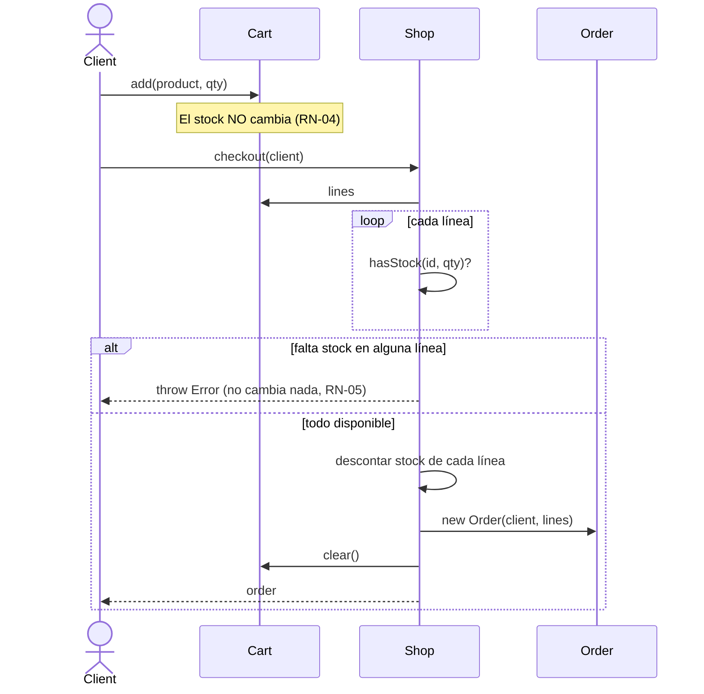

# Memoria técnica — Tienda de Ropa

> Versión 0.1 · Fase 1 (modelo de dominio) · Octubre 2026
> Las secciones marcadas con ✏️ las completa cada equipo antes de programar.

---

## 1. Descripción del proyecto

Aplicación web de comercio electrónico para una tienda de ropa y complementos. Un **cliente** puede consultar el catálogo, filtrarlo, añadir prendas a su carrito y realizar un pedido. Un **trabajador** puede dar de alta productos y gestionar el stock.

El catálogo se obtendrá de una API pública (DummyJSON). El stock inicial lo proporciona la API; a partir de ahí, la aplicación lo gestiona en memoria.

### 1.1 Objetivos de aprendizaje
- Modelar un dominio real con clases, herencia, composición, getters y miembros estáticos/privados.
- Separar la **lógica de negocio** de la **presentación** (DOM) y del **acceso a datos** (API).
- Documentar requisitos y estructuras de datos **antes** de escribir código.

### 1.2 Alcance
| Dentro | Fuera |
|---|---|
| Catálogo, filtros, búsqueda | Pasarela de pago real |
| Carrito y pedidos | Registro / login real (se simula) |
| Gestión de stock por trabajadores | Backend propio y base de datos |
| Persistencia en `localStorage` (fase 2) | Envíos, devoluciones, facturación |

---

## 2. Actores

| Actor | Descripción |
|---|---|
| **Cliente** | Usuario que navega y compra. Tiene un carrito y un historial de pedidos. |
| **Trabajador** | Empleado de la tienda. Puede añadir productos, reponer stock y retirar productos del catálogo. |
| **Sistema / API** | Fuente externa del catálogo inicial (DummyJSON). |

---

## 3. Requisitos

### 3.1 Requisitos funcionales

| ID | Requisito | Actor | Prioridad | Fase |
|---|---|---|---|---|
| RF-01 | Listar todos los productos del catálogo con su stock | Cliente | Alta | 1 |
| RF-02 | Filtrar productos por categoría | Cliente | Alta | 1 |
| RF-03 | Buscar productos por texto (título, marca, etiquetas) | Cliente | Media | 1 |
| RF-04 | Mostrar solo productos disponibles (stock > 0) | Cliente | Media | 1 |
| RF-05 | Añadir un producto al carrito indicando cantidad | Cliente | Alta | 1 |
| RF-06 | Quitar unidades o eliminar un producto del carrito | Cliente | Alta | 1 |
| RF-07 | Consultar total del carrito y número de artículos | Cliente | Alta | 1 |
| RF-08 | Realizar pedido (checkout) a partir del carrito | Cliente | Alta | 1 |
| RF-09 | Consultar historial de pedidos | Cliente | Baja | 1 |
| RF-10 | Dar de alta un producto con stock inicial | Trabajador | Alta | 1 |
| RF-11 | Reponer stock de un producto existente | Trabajador | Alta | 1 |
| RF-12 | Retirar un producto del catálogo | Trabajador | Media | 1 |
| RF-13 | Mostrar el catálogo en pantalla | Cliente | Alta | 2 |
| RF-14 | Conservar el carrito al recargar la página | Cliente | Media | 2 |
| RF-15 | Cargar el catálogo desde la API | Sistema | Alta | 3 |
| RF-16 | Mostrar estados de carga y error de la API | Cliente | Media | 3 |
| ✏️ RF-17 | *(propuesta del equipo)* | | | |

### 3.2 Requisitos no funcionales

| ID | Requisito |
|---|---|
| RNF-01 | JavaScript vanilla (ES2022+), sin frameworks. |
| RNF-02 | Las clases de dominio no acceden al DOM ni a `fetch`. |
| RNF-03 | Los importes se almacenan como **enteros en céntimos**. |
| RNF-04 | Los errores de negocio se señalan con `throw new Error(...)`, no con `console.log`. |
| RNF-05 | Código y nombres de clases/métodos en inglés; textos al usuario y documentación en español. |
| RNF-06 | Interfaz usable en móvil (fase 2). |

### 3.3 Historias de usuario (ejemplos)

- **HU-01** — *Como cliente, quiero filtrar por categoría para encontrar rápido lo que busco.*
  - ✅ Al elegir "womens-dresses" solo aparecen vestidos.
  - ✅ Al quitar el filtro vuelven a aparecer todos.
- **HU-02** — *Como cliente, quiero que no me deje comprar más unidades de las que hay.*
  - ✅ Si pido 5 y hay 3, el pedido no se crea y se informa del stock disponible.
  - ✅ El stock **no** cambia si el pedido falla.
- **HU-03** — *Como trabajador, quiero reponer stock sin duplicar el producto.*
  - ✅ Añadir un producto ya existente suma unidades a su stock.
- ✏️ **HU-04** — *(propuesta del equipo)*

---

## 4. Reglas de negocio

| ID | Regla |
|---|---|
| RN-01 | Un producto se identifica por su `id` (el que da la API). Nunca hay dos entradas con el mismo id en una tienda. |
| RN-02 | El stock es un entero ≥ 0. |
| RN-03 | Un producto con stock 0 **sigue en el catálogo** y se muestra como "agotado". Retirarlo es una acción explícita del trabajador. |
| RN-04 | Añadir al carrito **no reserva ni descuenta** stock. El stock se descuenta solo en el checkout. |
| RN-05 | El checkout es **todo o nada**: si una línea no tiene stock suficiente, no se descuenta nada y no se crea el pedido. |
| RN-06 | Precio final = `price × (1 − discountPercentage / 100)`, redondeado al céntimo. |
| RN-07 | El pedido guarda el precio unitario del momento de la compra; cambios posteriores de precio no le afectan. |
| RN-08 | Solo un `Worker` puede añadir productos, reponer o retirar del catálogo. |
| RN-09 | Un pedido nace en estado `pending`. Estados posibles: `pending → paid → shipped`, o `cancelled`. |

---

## 5. API y mapeo de datos

### 5.1 Elección de la API

Se evaluaron tres APIs públicas de comercio electrónico:

| API | Ropa | Stock | Sin API key | Valoración |
|---|---|---|---|---|
| **DummyJSON** | ~10 categorías de ropa y complementos | ✅ | ✅ | **Elegida** |
| FakeStoreAPI | Solo "men's clothing" / "women's clothing" (pocos productos) | ❌ | ✅ | Muy simple, sin stock |
| Platzi Fake Store | "Clothes", "Shoes" | ❌ | ✅ (lectura) | Datos editables por cualquiera; a veces aparecen productos basura |

**Motivos:** DummyJSON devuelve el campo `stock` (encaja directamente con nuestra lógica de inventario), además de marca, descuento, valoración, reseñas e imágenes. También ofrece endpoints de usuarios y carritos por si se quiere ampliar.

### 5.2 Formato de un producto en DummyJSON

`GET https://dummyjson.com/products/{id}` (campos relevantes; se omiten `dimensions`, `meta`, `sku`, etc.)

```json
{
  "id": 81,
  "title": "Blue & Black Check Shirt",
  "description": "…",
  "category": "mens-shirts",
  "price": 29.99,
  "discountPercentage": 10,
  "rating": 4.2,
  "stock": 38,
  "tags": ["clothing", "shirts"],
  "brand": "Fashion Trends",
  "availabilityStatus": "In Stock",
  "reviews": [{ "rating": 4, "comment": "…", "date": "…", "reviewerName": "…" }],
  "thumbnail": "https://cdn.dummyjson.com/…/thumbnail.webp",
  "images": ["https://cdn.dummyjson.com/…/1.webp"]
}
```

Los listados vienen envueltos: `{ "products": [...], "total": 30, "skip": 0, "limit": 30 }`.

### 5.3 Mapeo API → modelo

| Campo API | Clase / propiedad | Transformación |
|---|---|---|
| `id` | `Product.id` | Ninguna. **Sustituye al contador estático** del borrador. |
| `title` | `Product.title` | Ninguna (antes `name`). |
| `category` | `Product.category` | Ninguna (slug: `mens-shirts`). |
| `price` | `Product.price` | `Math.round(price * 100)` → céntimos. |
| `discountPercentage` | `Product.discountPercentage` | Ninguna. |
| `brand`, `rating`, `tags`, `thumbnail`, `images`, `description` | `Product.*` | Ninguna. |
| `stock` | `Shop.inventory.get(id).stock` | **No va en `Product`**: el stock es de la tienda, no del artículo. |
| `availabilityStatus` | — | Se calcula con `stock`, no se guarda. |
| `reviews` | — | Fuera de alcance en fase 1 (extra en fase 3). |

La conversión se centraliza en `Product.fromApi(json)` para que, si la API cambia, solo haya que tocar un sitio.

---

## 6. Diseño del modelo

Diagrama de clases completo: [`diagrama-clases.md`](diagrama-clases.md).

### 6.1 Decisiones de diseño

| Decisión | Motivo |
|---|---|
| `Shop.inventory` es un único `Map<id, {product, stock}>` | El borrador tenía `products[]` + `Map` de stock por separado y se desincronizaban (ver 6.2). |
| La categoría es una **propiedad**, no una subclase (`Shirt extends Product` eliminado) | Las subclases solo tienen sentido si cambian el **comportamiento**. Una camisa y un vestido se comportan igual; tener una clase por categoría obliga a crear una clase nueva por cada categoría de la API. |
| `Client` y `Worker` heredan de `User` y se diferencian por `canManageStock()` | Ahora la herencia sí aporta comportamiento distinto (polimorfismo), no solo una etiqueta. |
| `Cart` separado de `Shop` | El carrito pertenece al cliente; la tienda solo interviene en el checkout. |
| `LineItem` reutilizado por `Cart` y `Order` | Misma estructura (producto + cantidad + precio). Evita duplicar el cálculo de subtotales. |
| Precios en céntimos | `0.1 + 0.2 !== 0.3` en JS. Con enteros los totales son exactos. |
| Errores con `throw` | Quien llama (consola hoy, DOM mañana) decide cómo mostrarlos. Con `console.log` la interfaz no se entera de que algo falló. |
| Campos privados `#` | `Order.#lastId` y `Shop.#assertWorker` no deben usarse desde fuera. |

### 6.2 Revisión del primer borrador

Problemas detectados en el código inicial y cómo se resuelven:

| # | Problema | Consecuencia | Solución |
|---|---|---|---|
| 1 | `id` generado con `static totalProducts` | Choca con los `id` de la API (el producto 1 local ≠ producto 1 de DummyJSON). | Usar el `id` que viene de la API. |
| 2 | `products[]` y `stock` por separado | En `removeProduct` con stock 0 se borra el producto del array pero **no** su entrada del `Map`. | Una sola estructura `inventory`. |
| 3 | `removeProduct` mezcla "vender", "retirar del catálogo" y "corregir errores" | Lógica difícil de seguir; al vender todas las unidades el producto desaparece del catálogo. | Separar: el stock baja en `checkout`; retirar es `removeProduct` explícito (RN-03). |
| 4 | `getProducts()` hace `{...product}` | El spread **no copia getters** del prototipo: `priceEuro` se pierde en el objeto devuelto. | Devolver `{ product, stock }` manteniendo la instancia. |
| 5 | Errores con `console.log` y `return false` | La interfaz no puede mostrar el motivo del error. | `throw new Error(mensaje)`. |
| 6 | Categorías inconsistentes (`"shirt"` vs `"camiseta"`) | Los filtros fallan. | Usar los slugs de la API. |
| 7 | `Client` y `Worker` vacíos | La herencia no aporta nada; cualquiera puede tocar el stock. | Comportamiento propio (`canManageStock`, carrito, pedidos). |
| 8 | Falta carrito y pedido | No se puede representar una compra. | Clases `Cart`, `LineItem`, `Order`. |

### 6.3 Flujo de compra (checkout)



---

## 7. Plan de trabajo

| Fase | Entregable | Archivos |
|---|---|---|
| 1 | Modelo probado en consola | `src/model.js`, `src/demo.js` |
| 2 | Interfaz con datos de ejemplo | `index.html`, `styles.css`, `src/ui.js` |
| 3 | Catálogo desde la API | `src/api.js` |

Arquitectura objetivo (cada capa solo conoce a la de abajo):

```
ui.js  (DOM, eventos)  ──►  model.js (lógica de negocio)  ◄──  api.js (fetch + Product.fromApi)
```

---

## 8. ✏️ Pendiente de definir por el equipo

- [ ] ¿Qué pasa si un cliente añade al carrito más unidades de las que hay en stock? ¿Se avisa ya en el carrito o solo en el checkout?
- [ ] ¿Se aplica algún descuento extra (cupón, envío gratis a partir de X €)?
- [ ] ¿Cómo se simula el "usuario actual"? ¿Selector cliente/trabajador en la interfaz?
- [ ] ¿Qué se guarda en `localStorage` y en qué formato? (Ojo: `JSON.stringify` pierde las clases → habrá que reconstruirlas.)
- [ ] ¿Tallas y colores? DummyJSON no los trae: ¿se descartan o se inventan como variantes?